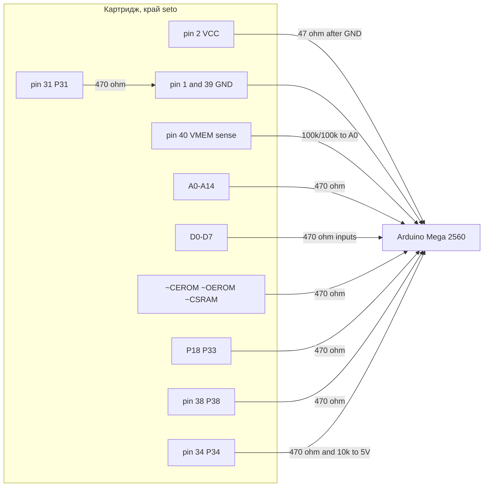

# Дампер картриджа CK-35, только чтение

Схема и таблица выведены из `knitting-cart/brothercart.sch` (коммит seto `fae0a1b`). Это изменённая документация по CERN OHL 1.2, см. `MODIFICATIONS.md`. Настоящий картридж CK-35 по фото ETI Berlin — та же семья платы, но прозвонка всё равно обязательна до питания.

Скетч Mega ничего не пишет. Команды записи нет.

## Сначала снять дамп, потом машина

По [заметке ETI Berlin, 16 декабря 2013](https://etiberlin.wordpress.com/2013/12/16/the-ck-35-what-i-have-learned-so-far/): у CK-35 нет встроенных узоров. Картридж, вставленный в главную фонтуру, очищает память машины. Машина умеет выгрузить свою память обратно в картридж. Узоры набивает PPD-35, и он тоже пишет в картридж. У автора той заметки батареи в картриджах уже сели, и узоры проверить было нельзя.

Поэтому:

1. Измерить батарею на плате (элемент B1 на фото, у seto это `BT1`) до любых включений. Мёртвые элементы на этих картах обычное дело. Если на элементе меньше примерно 2,5 В, ОЗУ уже может быть пустым. Элемент не вынимать и не перепаивать: от этого содержимое не появится.
2. Снять дамп этим читателем.
3. Только после этого вставлять картридж в CK-35 или в PPD. И то и другое умеет записать поверх того, что сейчас в ОЗУ.

Фото вскрытой платы: [ck-35-cart.jpg](https://etiberlin.wordpress.com/wp-content/uploads/2013/12/ck-35-cart.jpg) и оборот [ck-35-cart2.jpg](https://etiberlin.wordpress.com/wp-content/uploads/2013/12/ck-35-cart2.jpg). На компонентной стороне читается маркировка платы `B442076-1`, Hitachi `HM62256LFP-12T`, пустая колодка DIP-28 с подписью `27C256` / `27C512`, диод `D1`, место батареи `B1`, три корпуса SOIC с номерами 3, 4 и 5. На обороте виден дисковый элемент и ещё одна микросхема в SOIC. Золотые пальцы видны и на лице, и на обороте язычка: край двусторонний, не односторонний край вышивальной карты. На шелкографии у язычка ряд меток вида 1…9 и A…K, это 20 меток на одну сторону. Шаг в миллиметрах по снимку 638×425 не измеряется. Совпадение с футпринтом seto `2×20`, шаг 1.27 мм правдоподобно и **не доказано** этим кадром.

Пустая колодка ПЗУ значит, что на этом экземпляре CK-35 заводского ПЗУ нет. Дамп области ROM может быть пустым или плавающим. Пользовательские узоры, если батарея жива, лежат в HM62256. У seto на Stitch Pattern Cartridge II ПЗУ было запаяно. Семья платы одна, набивка разная. Логики на фото больше, чем два корпуса и транзистор на листе seto: уравнения ниже для `B442076-1` не считать полными.

Руководства, на которые ссылается та же заметка, страницы открываются:

- [Brother CK-35 User Guide](https://mkmanuals.com/brother-ck-35-user-guide.html) (в блоге было `machineknittingetc.com/brother-ck-35-user-guide.html`, сейчас редирект сюда)
- [CK-35 parts manual](https://mkmanuals.com/brother-ck35-parts-manual.html)
- [PPD for CK-35, user guide](https://mkmanuals.com/brother-ppd-for-ck35-patterning-device-user-guide.html) — в комментариях к заметке английский экземпляр не нашли, есть немецкий

В этих страницах нет распиновки края. Байтовый формат узора они тоже не заменяют.

## Карта контактов

Номер — это номер вывода символа `Conn_02x20_Odd_Even` и площадки футпринта Samtec MECF-20 в файлах seto. Геометрия символа из `brothercart-cache.lib` (матрица `1 0 0 -1`, позиция компонента) сошлась с сетями на `brothercart.kicad_pcb`. Это высокая уверенность **в файлах**. Какой физический палец картриджа CK-35 есть контакт 1, фото не говорит: шелкография «1» и KiCad «1» ещё не прозванивались.

Нечётные номера — один ряд символа, чётные — второй. На плате это две стороны язычка.

| Контакт | Имя в brothercart.sch | Имя в emulator.sch | Куда на дампере | Уверенность |
| --- | --- | --- | --- | --- |
| 1 | GND | GND | GND Mega, первым | файлы seto; на картридже прозвонить |
| 2 | VCC | +5V | 5V Mega через 47 Ом, после GND | то же |
| 3 | D2 | D2 | Mega 39, только вход, через 470 Ом | то же |
| 4 | D3 | D3 | Mega 40, вход | то же |
| 5 | D1 | D1 | Mega 38, вход | то же |
| 6 | D4 | D4 | Mega 41, вход | то же |
| 7 | D0 | D0 | Mega 37, вход | то же |
| 8 | D5 | D5 | Mega 42, вход | то же |
| 9 | A0 | A0 | Mega 22, выход | то же |
| 10 | D6 | D6 | Mega 43, вход | то же |
| 11 | A1 | A1 | Mega 23, выход | то же |
| 12 | D7 | D7 | Mega 44, вход | то же |
| 13 | A2 | A2 | Mega 24 | то же |
| 14 | ~CEROM | ~CEROM | Mega 46, активный низкий | то же |
| 15 | A3 | A3 | Mega 25 | то же |
| 16 | A10 | A10 | Mega 32 | то же |
| 17 | A4 | A4 | Mega 26 | то же |
| 18 | P18 | ~OERAM1 | Mega 49 | имя P18 — метка прозвонки; функция взята из листа эмулятора, на CK-35 не проверена |
| 19 | A5 | A5 | Mega 27 | файлы seto |
| 20 | ~OEROM | ~OEROM | Mega 47 | файлы seto |
| 21 | A6 | A6 | Mega 28 | файлы seto |
| 22 | A11 | A11 | Mega 33 | файлы seto |
| 23 | A7 | A7 | Mega 29 | файлы seto |
| 24 | A9 | A9 | Mega 31 | файлы seto |
| 25 | A12 | A12 | Mega 34 | файлы seto |
| 26 | A8 | A8 | Mega 30 | файлы seto |
| 27 | A14 | A14 | Mega 36 | файлы seto |
| 28 | A13 | A13 | Mega 35 | файлы seto |
| 29 | нет сети | нет сети | не подключать | оба листа |
| 30 | ~CSRAM | ~CSRAM | Mega 48 | файлы seto |
| 31 | P31 | WERAM1 | **470 Ом на GND, не на GPIO** | запись держим неактивной железом |
| 32 | нет сети | нет сети | не подключать | оба листа |
| 33 | P33 | ~OERAM2 | Mega 50 | функция с листа эмулятора, не проверена |
| 34 | P34 | ~WERAM2 | Mega 51, только HIGH, плюс 10 кОм к 5 В | второй замок записи |
| 35 | нет сети | нет сети | не подключать | оба листа |
| 36 | нет сети | нет сети | не подключать | оба листа |
| 37 | нет сети | нет сети | не подключать | оба листа |
| 38 | P38 | LRAM | Mega 52, такт защёлки A13/A14 | 74HC74 на листе seto; на фото CK-35 состав логики другой |
| 39 | GND | GND | GND | файлы seto |
| 40 | VMEM | +5V на листе эмулятора | только к делителю A0, **не к 5 В** | расхождение двух листов seto; на фото есть батарея |

A0…A14 сидят на Mega 22…36 по порядку. D0…D7 на 37…44. Подтяжки 10 кОм к 5 В ставить на стороне картриджа, до последовательных 470 Ом, на ~CEROM, ~OEROM, ~CSRAM, P18, P33, P34. P38 подтянуть 10 кОм к GND, чтобы защёлка не щёлкала, пока Mega в сбросе. P31 только на GND.

Почему так с записью. На `brothercart.sch` вывод ~WE самой HM62256 — внутренняя сеть `~WERAM`, на край она не выходит. Её собирает 74HC4075. Один вход этой сборки на листе не подключён (провод не нарисован). Второй вход — коллектор UN1211, база которого сидит на P31, эмиттер на GND, коллектор подтянут 4,7 кОм к VCC. Третий вход — P34. Пока неизвестный вход не прозвонен, надёжное чтение такое: P31 держать низким железом, P34 держать высоким. Тогда известные входы не собирают низкий ~WE. Лист эмулятора называет эти же контакты `WERAM1` и `~WERAM2`, то есть автор сам считал их стробами записи. На дампере их нельзя «проверить, дёрнув».

Контакт 40 на ретрейсе — `VMEM`, питание ОЗУ от батареи через 2,2 кОм и 1N4148. На листе эмулятора тот же контакт просто привязан к +5V. Замыкать его на 5 В Mega нельзя: это может сесть на батарею. Делитель 100 кОм / 100 кОм на A0 только измеряет.

## Что делает скетч

`mega/ck35_dump/ck35_dump.ino`.

- После сброса все стробы неактивны: ~CE/~OE/~CS вверху, P34 вверху, P38 внизу.
- Печатает оценку VMEM. Ниже 2 В предупреждает, что батарея села или контакт 40 не тот.
- Ждёт букву `G`.
- 32768 байт ROM: адрес на A0…A14, ~CEROM и ~OEROM вниз, ~CSRAM вверх. Если колодка 27C256 пустая, как на фото CK-35, здесь не будет узоров.
- 32768 байт RAM: на каждый адрес поднимает P38 (на листе seto это фронт 74HC74, который защёлкивает A13 и A14 в старшие адреса ОЗУ) и читает при ~CSRAM вниз и P18/P33 вниз. Это гипотеза про OE, не измерение CK-35. P34 при этом остаётся высоким, P31 сидит на земле.
- В UART уходит только этот поток. Записи нет.

Сохранить файлы:

```bash
pip install -r hardware/dumper/tools/requirements.txt
python3 hardware/dumper/tools/save_dump.py /dev/ttyACM0
```

Скрипт пишет `ck35-rom.bin` и `ck35-ram.bin` в текущий каталог. Порт Mega открывается заново, плата при этом сбрасывается. Питание картриджа к этому моменту уже должно быть подано, иначе дамп пустой.

## Прозвонка до питания

1. Батарею измерить на её выводах. Не прозванивать батарею в режиме прозвонки мультиметра.
2. Посчитать пальцы с обеих сторон язычка и измерить шаг. Ориентир seto: 20 + 20, 1,27 мм. Если не сходится, таблицу контактов не паять.
3. Найти GND и VCC по ногам HM62256 (даташит SOP-28) и по пустой колодке 27C256. Сверить с контактами 1, 2 и 39.
4. Контакт, который звонится на батарею или на VCC ОЗУ, — это кандидат в VMEM. Его не сажать на 5 В.
5. Найти ~WE ОЗУ. На лист seto он не выходит на край. Если на этом экземпляре ~WE всё же звонится на палец, этот палец посадить на 5 В через 470 Ом и не отдавать GPIO.
6. Остальные пальцы сверить с таблицей. Пустые 29, 32, 35, 36, 37 так и оставить пустыми, если они никуда не звонятся.
7. Общий GND Mega и картриджа. Потом 5 В только на контакт 2, через 47 Ом, в разрыв миллиамперметр. Ток логики этой платы — десятки миллиампер, не сотни. Сотни миллиампер: снять питание.
8. Только потом `G`.

Рисунок: `wiring.svg`. Тот же состав в `ck35-dumper.kicad_sch`.



## BOM

| Позиция | Номинал | Зачем |
| --- | --- | --- |
| Плата | Arduino Mega 2560 | 5 В GPIO, хватает ног |
| Колодка края | под измеренный шаг; ориентир Samtec MECF-20, 1,27 мм, 2×20 | не паять навсегда на оригинальный язычок, пока шаг не измерен |
| R1–R32 | 470 Ом | последовательно в каждый сигнал, включая P31 на землю |
| R33 | 47 Ом | в разрыв VCC, первое включение |
| R34, R35 | 100 кОм | делитель VMEM на A0 |
| R36–R41 | 10 кОм | подтяжки ~CEROM, ~OEROM, ~CSRAM, P18, P33, P34 к 5 В |
| R42 | 10 кОм | P38 к GND |
| Провода, миллиамперметр | | ток при первом 5 В |

Питание Mega от USB. Второй блок питания не добавлять. Плату из `legacy/pcb-esp32` не использовать.
